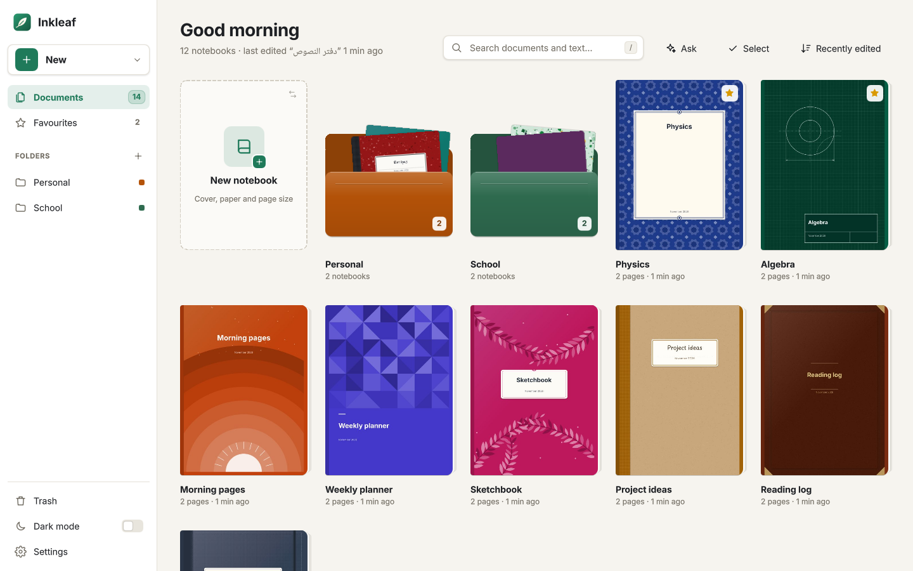
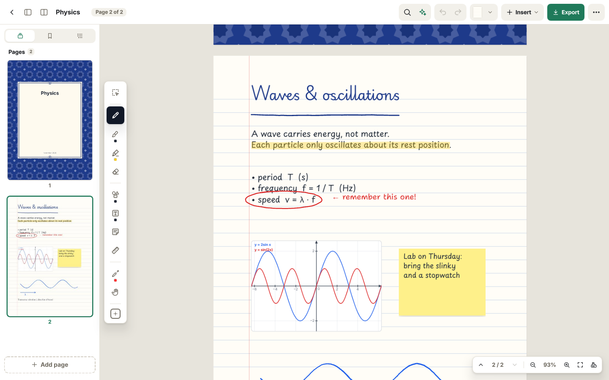
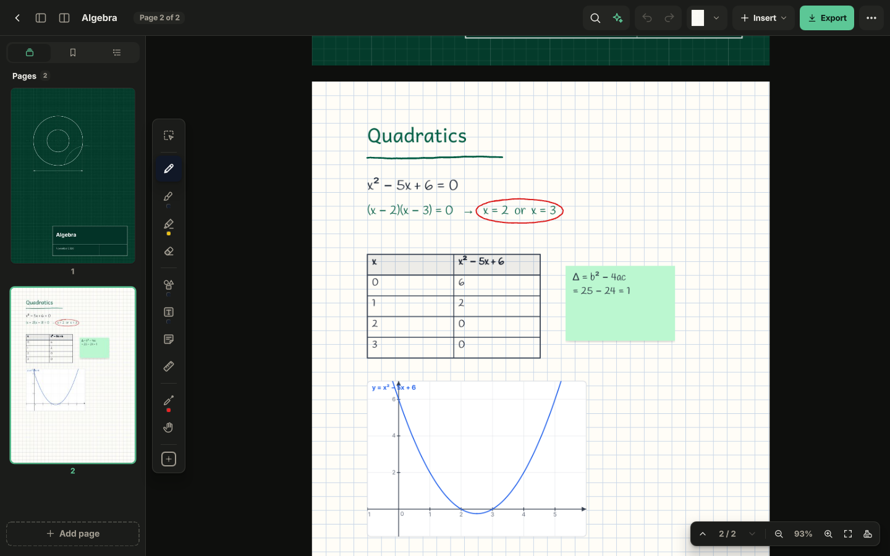
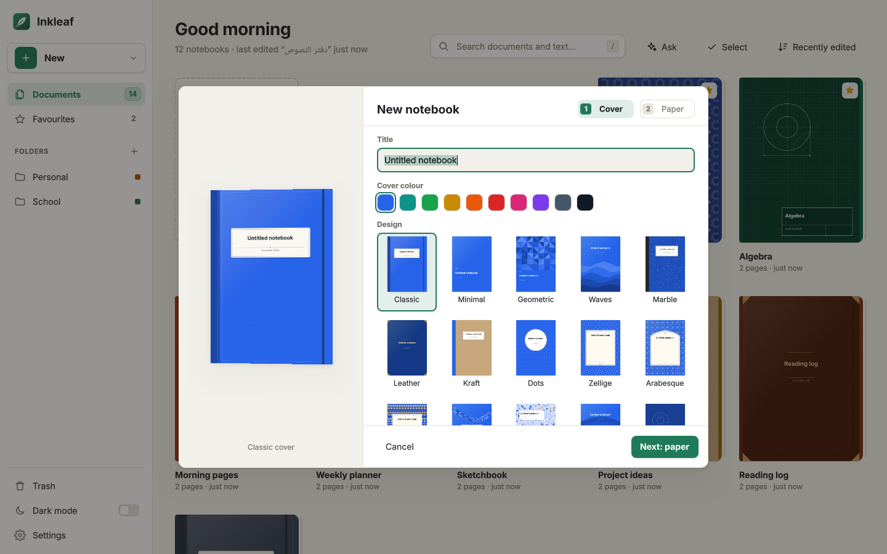
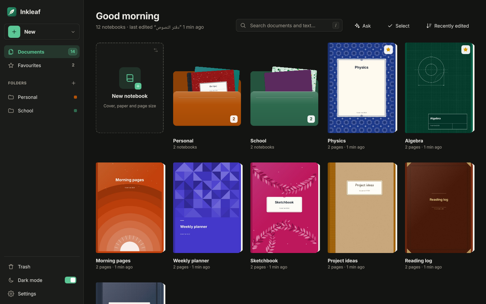
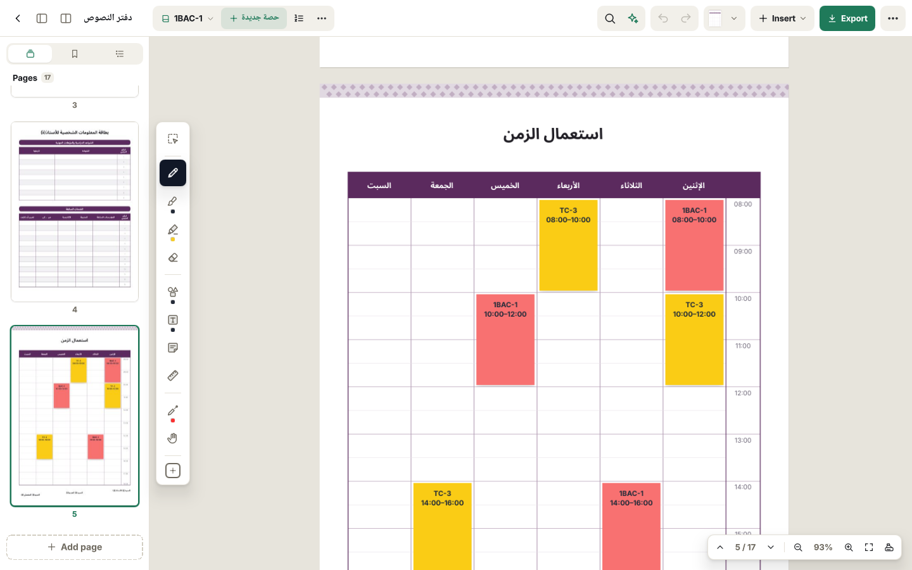
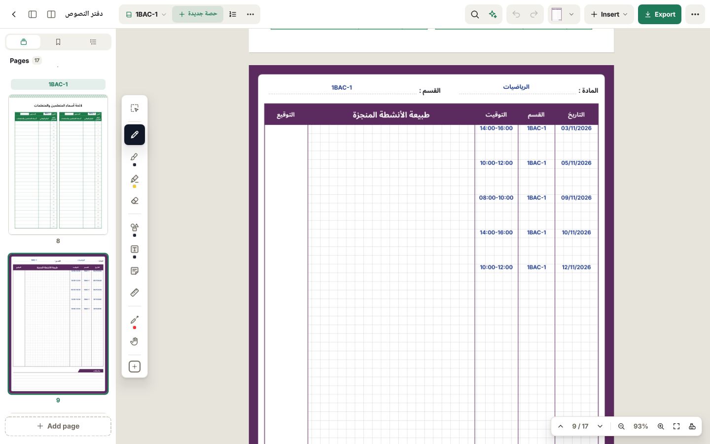

<div align="center">


# Inkleaf

**Handwritten notes, done properly — on your computer and your tablet.**

Pressure-sensitive ink, shapes that tidy themselves, maths that solves itself,
beautiful notebooks and papers, PDF annotation, an optional AI assistant, and
sync through your own Google Drive. Everything stays on your device.

[](https://github.com/sadikBr/inkleaf/releases/latest)


[](https://github.com/sadikBr/inkleaf/actions/workflows/qt.yml)

[Download](#download) · [Features](#features) · [Build from source](#build-from-source) · [Changelog](CHANGELOG.md)

<br>



</div>

## Why Inkleaf

- **Ink that feels like ink.** Fountain pen, ballpoint, fineliner, pencil, calligraphy and a box of brushes, drawn on the GPU with pressure, speed and smooth tapering, so it looks the same on screen, zoomed in and in exports.
- **It tidies up after you.** Hold the pen still at the end of a stroke and a wobbly box becomes a rectangle, a circle becomes a circle and a scribble of ∫ becomes ∫. Lines snap to angles, join corners and go square or parallel to each other.
- **Made for school.** Graphs, tables, a maths solver, a ruler, protractor and set squares, 20+ papers (Cornell, graph paper, isometric, planners…) and a full Moroccan *daftar annossous* (teacher's lesson log).
- **Yours.** A local SQLite library, no account needed. Sync goes through a hidden folder in *your* Google Drive; notebooks can be locked with a password and encrypted end-to-end.

## Screenshots

<table>
  <tr>
    <td width="50%"></td>
    <td width="50%"></td>
  </tr>
  <tr>
    <td align="center"><sub>Notes with ink, highlighter, a graph and a sticky note</sub></td>
    <td align="center"><sub>Dark mode: tables, graphs and maths on grid paper</sub></td>
  </tr>
  <tr>
    <td></td>
    <td></td>
  </tr>
  <tr>
    <td align="center"><sub>Pick a cover design and colour, with a live preview</sub></td>
    <td align="center"><sub>The library in dark mode</sub></td>
  </tr>
  <tr>
    <td></td>
    <td></td>
  </tr>
  <tr>
    <td align="center"><sub>Daftar annossous: the timetable fills itself in</sub></td>
    <td align="center"><sub>…and <i>New lesson</i> logs today's lesson in one tap</sub></td>
  </tr>
</table>

## Download

Get the latest version from the **[Releases page](https://github.com/sadikBr/inkleaf/releases/latest)**:

| System | File | How to install |
| --- | --- | --- |
| **Windows 10 / 11** (64-bit) | `Inkleaf_<version>_windows_x64_setup.exe` | Run the installer. It adds Inkleaf to the Start menu and updates itself in the future. |
| Windows, portable | `Inkleaf_<version>_windows_x64.zip` | Unzip anywhere and run `Inkleaf.exe`. No installation, no automatic updates. |
| **Linux** (x86-64) | `Inkleaf_<version>_x86_64.AppImage` | `chmod +x Inkleaf_*.AppImage` then run it. Works on most distributions. |
| **Android** tablets and phones (arm64, Android 9+) | `Inkleaf_<version>_android_arm64.apk` | Open the APK on the device and allow *Install unknown apps* for your browser or file manager when asked. |

> [!NOTE]
> Windows may show a SmartScreen warning because the installer isn't code-signed. Choose **More info → Run anyway**.

**Updates are built in.** When a new version is out, Inkleaf shows a banner with what's new and an **Update now** button. It downloads the new version, checks it against the checksum GitHub publishes, saves your open notebook and restarts into it. The Windows installer and the AppImage update themselves, and on Android the system asks you to confirm. Automatic checks can be turned off in *Settings → Updates*.

macOS and iOS aren't supported yet.

## Features

### Writing and drawing

- **Pens:** fountain pen (pressure and speed sensitive), ballpoint, fineliner, pencil with grain and a flat-nib calligraphy pen. Solid, dashed or dotted lines.
- **Brushes:** brush pen, ink brush, flat brush, airbrush, marker, watercolour, neon, chalk, crayon and washi tape. Plus a translucent highlighter that draws straight lines when you hold it.
- **Smooth, honest ink:** one smooth outline per stroke with crisp corners. Smoothing and pressure are adjustable, and every stroke keeps its look at any zoom and in exports.
- **Eraser:** *precise* (cuts strokes) or *whole stroke*. It grows when you rub fast. You can also **scribble over ink** with the pen to erase it.
- **Lasso and selection:** move, resize, rotate, recolour, duplicate, copy and paste anything. Arrow keys nudge it. Press and hold on handwriting to select a word.
- **Palm rejection and pen-only mode** for tablets with a stylus. The pen's side button and eraser end work too. Two-finger tap undoes and three-finger tap redoes.
- **Write from your phone:** no touch screen? Scan a QR code and your phone becomes a writing pad for the page on your computer. Nothing to install.

### Shapes, geometry and maths

- **Hold to refine:** hold still at the end of a stroke and it becomes a clean line, arc, box, circle, triangle, brace or maths symbol (∫ Σ √ ∞ ≠ ⇒ ≤ ± ∀ …). Keep holding to rotate and resize it before you lift.
- **22 shapes** in a tile picker (arrows, polygons, stars, hearts, clouds, speech bubbles…), with fill and dashes. Marks for equal sides and right angles.
- **Drafting help:** lines settle on round angles, join nearby ends, go square or parallel to other lines, and show their angle and length in cm. Tap to place named points A, B, C. **Make it neat** turns a rough drawing into clean shapes in one step.
- **Ruler, protractor and set squares** with real-size markings. Strokes drawn along an edge follow it, with a live length or angle readout.
- **Maths solver:** select a sum, an equation or a function (typed or handwritten) and press ∑. You get the value, a ✓ check, the solution of an equation in one unknown, or an expansion. Then write the answer next to it, typeset it, see the steps or graph it.
- **Graphs:** *Insert → Graph* plots one or more functions (y = x² − 2x, f(x) = 2 sin x…) as a page element you can write on.
- **Tables:** draw a rough grid and choose *Make table*, or insert one. Type in the cells, resize rows and columns, and add a header row.

### Notebooks, pages and paper

- **Library:** notebooks on a shelf with full-size covers, nested folders, favourites, search over titles, typed text, PDFs and AI-read handwriting, and a trash. Multi-select works too.
- **15 cover designs** (Classic, Leather, Kraft, Marble, Zellige, Arabesque, Berber rug, Botanical, Terrazzo, Sunrise, Blueprint…) in any colour, with the title on the cover.
- **20+ paper styles:** blank, ruled (narrow and wide), grid, dotted, Cornell, legal pad, two columns, to-do, millimetre graph paper, coordinate plane, isometric, hexagon, handwriting practice, calligraphy guide, storyboard, and daily and weekly planners. They come in A4, A5, Letter, Legal or square, portrait or landscape, on white, cream, yellow, grey or dark paper. **Save any page as your own template.**
- **More kinds:** sketchbooks (blank landscape) and an endless **whiteboard** that grows as you write near its edges.
- **Pages:** continuous scrolling, thumbnails, an *All pages* grid with drag-to-reorder, bookmarks, a contents panel and contents page, links between pages, and *Recently deleted* for 30 days.
- **Text:** text boxes and sticky notes with bold, italic, lists and alignment, and **11 bundled fonts** (Inter, Lora and 9 handwriting fonts). Full **Arabic** and right-to-left support.
- **Pictures:** insert, paste, crop to a rectangle, rounded or circle shape. **My pieces** keeps any selection (a diagram, a signature, a stamp) to reuse anywhere.
- **Side by side:** open a textbook PDF next to your notes and write in both.

### PDFs, export and presenting

- **Import PDFs** (slides, papers, worksheets) and annotate them. Pages render sharply at any zoom, offline.
- **Export** a notebook, a page or just a selection as a **vector PDF** (with its contents in the reader's sidebar), **PowerPoint** or **PNG**, including transparent PNGs.
- **Present** (F5): the page goes full screen on a projector while your tools stay on your screen. There's a **laser pointer** with a glowing trail or a dot.
- **Find in a notebook** (Ctrl+F) across typed text, tables, PDF text and AI-read handwriting.

### For teachers: daftar annossous (دفتر النصوص / cahier de textes)

*New → Daftar annossous* creates a complete Moroccan lesson log laid out like the printed books. It has a bilingual title page, the teacher's card, the timetable, holidays, a diagnostic report, a student list and lesson pages per class (each class in its own colour), memos and absences.

- **New lesson** writes today's date, class and lesson time from your timetable on the next free line, adding pages as needed. A lesson outline goes in with one tap.
- **Paste the student list** from Massar or Excel.
- **Export a class as PDF** for the inspector: the whole year, a semester or a month.
- Holidays (with Morocco's national holidays a click away) fill themselves in, and *New lesson* warns you on a holiday.

### AI assistant (optional)

Bring your own model: **a local one** (Ollama, LM Studio or any OpenAI-compatible server) or **your own API key** for Claude, ChatGPT or Gemini (*Settings → AI*).

- **Ask** about your notes in any language. Answers come from your pages, PDFs and handwriting.
- On a selection: **explain, solve step by step, summarise, translate, check spelling**, or turn handwriting into typed text in a handwriting font.
- The assistant can also **make things for you**: worksheets, summaries, tables, notebooks and folders, and daftar lessons following your timetable. It always shows the plan first, and one *Undo* takes it all back.
- *Make handwriting searchable* reads handwritten pages in the background.
- Your API key stays on your device (never in backups or sync). Locked notebooks are never read.

### Sync, backups and privacy

- **Google Drive sync** keeps your computer, tablet and phone the same. Files live in Drive's hidden app folder, which only Inkleaf can see. Conflicts keep both versions.
- **Daily backups** to any folder (a USB key, or a Dropbox or OneDrive folder), keeping the newest 7, 14 or 30. Use *Export everything* and *Restore* to move or recover a library.
- **Password lock** for notebooks and folders: content is encrypted with Argon2id and XChaCha20-Poly1305 on the device, in backups and in sync. There's no recovery if you forget the password.

### Keyboard shortcuts

| Key | Action | Key | Action |
| --- | --- | --- | --- |
| P | Pen | Ctrl+Z / Ctrl+Shift+Z | Undo / redo |
| B | Brush | Ctrl+C / Ctrl+V / Ctrl+D | Copy / paste / duplicate |
| H | Highlighter | Delete | Delete selection |
| E | Eraser | Ctrl+A | Select all |
| L | Lasso | Ctrl+F | Find in notebook |
| S | Shape | Ctrl+= / Ctrl+- | Zoom in / out |
| T | Text box | Ctrl+0 / Ctrl+9 | Fit width / whole page |
| N | Sticky note | ← / → (PgUp / PgDn) | Previous / next page |
| K | Laser pointer | F5 | Present |
| R | Ruler and instruments | F | Focus mode |
| Z | Zoom box | `[` | Show / hide pages |
| `/` | Search the library | `?` | Every shortcut and gesture |

## Build from source

Inkleaf is a **Qt 6** app (QML and C++, with ink drawn on the GPU) on a **Rust** core (SQLite library, ink geometry, recognition, export, sync). CMake builds both; there's no Node or script step.

**You'll need** Qt 6.5+ (Quick, Controls, Svg and PDF; CI uses 6.8.3), CMake 3.21+, a C++17 compiler and Rust stable.

### Linux

```bash
# Arch
sudo pacman -S --needed qt6-base qt6-declarative qt6-svg qt6-webengine cmake base-devel rustup
rustup default stable

# Ubuntu / Debian
sudo apt install qt6-base-dev qt6-declarative-dev qt6-svg-dev qt6-pdf-dev cmake build-essential \
  qml6-module-qtquick-controls qml6-module-qtquick-layouts qml6-module-qtquick-window \
  qml6-module-qtquick-templates qml6-module-qtquick-dialogs qml6-module-qt-labs-folderlistmodel \
  qml6-module-qt-labs-settings qml6-module-qtqml-workerscript
curl https://sh.rustup.rs -sSf | sh

# Build and run
cmake -S qt -B build/qt -DCMAKE_BUILD_TYPE=Release
cmake --build build/qt -j
./build/qt/inkleaf
```

(On Arch, `qt6-webengine` is the package that provides Qt PDF.)

### Windows

Install [Qt 6.8](https://www.qt.io/download-qt-installer) for **MSVC 2022 64-bit** with the *Qt PDF* module, plus [Visual Studio 2022](https://visualstudio.microsoft.com/) (Desktop C++), [Rust](https://rustup.rs) and Ninja. Then, in a *x64 Native Tools Command Prompt* with Qt's `bin` folder on the `PATH`:

```bat
cmake -S qt -B build/qt -G Ninja -DCMAKE_BUILD_TYPE=Release
cmake --build build/qt
windeployqt --release --qmldir qt/qml build/qt/inkleaf.exe
build\qt\inkleaf.exe
```

### Android

You need Qt for Android (arm64-v8a) along with the desktop Qt as the host, the Android SDK, NDK 26.1, JDK 17 and `rustup target add aarch64-linux-android`:

```bash
"$QT_ANDROID/bin/qt-cmake" -S qt -B build/android -G Ninja -DCMAKE_BUILD_TYPE=Release \
  -DQT_HOST_PATH="$QT_DESKTOP" -DANDROID_SDK_ROOT="$ANDROID_HOME" -DANDROID_NDK_ROOT="$NDK_HOME"
cmake --build build/android --target apk
```

### Good to know

- **No build needed to try the latest code:** every push to `main` runs **Actions → Qt app**, and its run artifacts include the AppImage, the Windows installer and zip, and the APK.
- **Your data** lives in the OS app-data folder (on Linux, `~/.local/share/app.inkleaf.desktop/inkleaf.db`). Set `INKLEAF_DATA_DIR=/some/folder` to use another library, for example to test.
- **Google Drive sync** in your own build needs `INKLEAF_GOOGLE_CLIENT_ID` and `INKLEAF_GOOGLE_CLIENT_SECRET` set at build time. See [docs/RELEASING.md](docs/RELEASING.md).
- `INKLEAF_WINDOW_SIZE=1000x700` opens the window at a given size (handy for checking phone layouts).

### Tests

```bash
cargo test -p inkleaf-core                                                     # Rust core: database, ink, recognition, export, sync
QT_QPA_PLATFORM=offscreen ./build/qt/inkleaf --self-test                       # C++ tests: geometry, lists, guides, daftar…
QT_QPA_PLATFORM=offscreen ./build/qt/inkleaf --golden check qt/tests/golden    # drawing and editor match the recorded results
QT_QPA_PLATFORM=offscreen ./build/qt/inkleaf --smoke                           # the app starts and its screens load
```

The reference results in `qt/tests/golden` are recorded by CI on its Qt version, and text can measure a hair differently on others. After an intended change to drawing, the editor or the daftar, run **Actions → Record reference results** to record and commit them again.

### Releasing

Bump the version with `python3 scripts/set-version.py X.Y.Z`, add a `## X.Y.Z` section to [CHANGELOG.md](CHANGELOG.md), then commit, tag `vX.Y.Z` and push. The **Release** workflow builds the AppImage, the Windows installer and zip and the signed APK, attaches them to a GitHub release, and installed apps offer the update. One-time setup (Android signing key, Google sign-in) is in [docs/RELEASING.md](docs/RELEASING.md).

## Project layout

```
qt/                   The app (Qt 6: QML screens, C++), see qt/README.md
  qml/                Screens (Library, Editor, Settings…), theme, icons
  src/editor/         The editor: tools, gestures, selection, undo, text, instruments
  src/draw/           Drawing: papers, covers, daftar pages, pens, shapes, text
  src/daftar/         The daftar annossous and cover setup
  src/math/           The maths solver and graphs
  src/tests/          Self-tests and the reference results' checks
  tests/golden/       Reference results (recorded by CI)
  native/             The C interface to the Rust core
  packaging/          Windows installer, Linux desktop files
core/                 Rust core: SQLite library, ink, shape and symbol recognition,
                      export (PDF/PPTX/PNG), backups, Google Drive sync, AI,
                      encryption, handwriting recognition (Windows Ink)
docs/                 Release guide, web pages (privacy, terms), screenshots,
                      reverse-engineering/ (Goodnotes web architecture reports)
scripts/              Versioning and release-notes helpers
```

## Not implemented yet

Real-time collaboration, and offline handwriting recognition outside Windows (reading handwriting with the AI works everywhere). [Report 05](docs/reverse-engineering/05-inkleaf-mapping.md) explains how each could be added.

## About this repository

The repository also contains the reports from studying how the Goodnotes web app is built (see [`docs/reverse-engineering/`](docs/reverse-engineering/README.md)). Inkleaf is an independent implementation informed by those findings. It contains no Goodnotes code, assets or branding.
